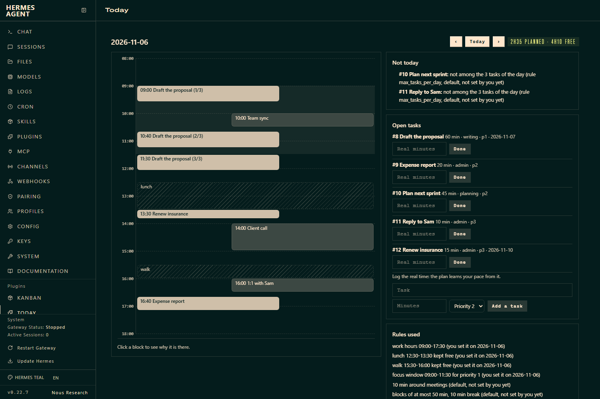

# Agenda Guardian

A day planner for Hermes that does not rely on your discipline.

You write your rules once, estimate each task, and say how long it really took. From the third finished task of a
kind, the planner corrects your estimates by **your own** median error. It places tasks in the free time around
your meetings, and every block says why it is where it is. A full day tells you what does not fit instead of
quietly overbooking. It can send a morning brief and nudge you when a block starts, with **no model call**.

It was built for one person's time blindness (ADHD, solo work, no boss to set the day) and it is useful to anyone
who plans more than the day allows.

- Deterministic: no model call anywhere, no API cost, same input gives the same plan.
- Any calendar: the Google Workspace skill, an ICS file or URL (Outlook, Apple, Google), a JSON file, or any
  command that prints event JSON.
- It never writes to a calendar.
- Works from the `/day` slash command, `hermes day` on the command line, six agent tools (so the onboarding can
  happen in a chat, including from a phone) and a **Today** tab in the dashboard.

## Quick start

```
hermes plugins install Moodtuner997/hermes-agenda-guardian
hermes plugins enable agenda-guardian
```

Then, in a chat:

```
/day setup                                   the questions, with your current answers
/day set work_hours=09:00-17:30 focus=09:00-11:30 protected=lunch@12:30-13:30 calendar=google
/day add "Write the quote" 45m cat=writing p=1 due=fri
/day plan                                    today, from now
/day plan tomorrow
/day done 1 70                               it really took 70 minutes
/day cron on 07:30                           morning brief + reminders (script-only jobs)
```

## What a plan looks like

Output of `hermes day plan tomorrow` on an invented profile (`tests/make_demo_profile.py`), shortened with `...`:

```
Plan for Fri 2026-11-06
3 task(s) planned, 2h35 of 4h10 free
09 #.=#.#.~~#==.~=#. 17
Day bar, 1 char = 30 min:  # task  = meeting  ~ protected  . free

09:00-09:35  [#] Draft the proposal (part 1/3)
       why: 105 min = your estimate 60 x 1.75 (median of 4 finished 'writing' tasks); due 2026-11-07; priority 1; in your focus window
10:00-10:30  [=] Team sync
10:40-11:15  [#] Draft the proposal (part 2/3)
       why: 105 min = your estimate 60 x 1.75 (median of 4 finished 'writing' tasks); due 2026-11-07; priority 1; in your focus window
...
16:40-17:10  [#] Expense report
       why: 30 min = your estimate 20 x 1.33 (median of 3 finished 'admin' tasks); priority 2

Not today:
- #10 Plan next sprint: not among the 3 tasks of the day (rule max_tasks_per_day, default, not set by you yet)

Rules used:
- work hours 09:00-17:30 (you set it on 2026-11-06)
- focus window 09:00-11:30 for priority 1 (you set it on 2026-11-06)
- at most 3 tasks a day (default, not set by you yet)
...
```

Every constraint is listed once under "Rules used", marked **you set it** or **default, not set by you yet**, so
you can see which rules are really yours.

## How it plans

1. **Free time** = work hours, minus calendar events (with a buffer around each), minus protected windows (lunch,
   a walk, the school run). All-day events are shown but do not block time.
2. **The day's tasks** are the first N (default 3) by due date, then priority. The rest are listed under "Not
   today" with the rule that left them out. Three things a day is a rule, not a limit of the code.
3. **Calibration.** Your estimate is multiplied by the median of (real time / estimate) for that category once
   you have three finished tasks in it, bounded to 0.7-3. Under three, your estimate is kept and the plan says
   how many are missing. The factor is shown in the block's reason.
4. **Blocks.** A task longer than the longest stretch you can hold (default 50 min) is cut into equal blocks with
   breaks. Priority 1 goes to your focus window first; other priorities stay out of it unless nothing else fits.
5. **All or nothing.** A task is placed in full or not at all, and a day that cannot hold it says by how many
   minutes it is short.

## Calendar sources

`/day set calendar=...`

| Value | Reads |
| --- | --- |
| `google` | the Google Workspace skill's script (`calendar list`), with your existing Google login |
| `ics:<path or https URL>` | an ICS file or the secret ICS address of a calendar (Outlook, Google, Apple) |
| `file:<path>` | a JSON file: a list of `{summary, start, end}` (the shape the Google script prints) |
| `cmd:<program and arguments>` | any program that prints that JSON; `{start}` and `{end}` are replaced by the day's UTC bounds; run without a shell |
| `none` | nothing; the plan says it ignores your meetings |

If the source cannot be read, the plan carries a visible warning instead of silently assuming an empty day.

ICS recurrence: `DAILY` and `WEEKLY` (with `INTERVAL`, `BYDAY`, `COUNT`, `UNTIL`, `EXDATE`) are expanded;
`MONTHLY` and `YEARLY` repeats are flagged in the plan, not guessed. Moved single occurrences of a recurring
event (`RECURRENCE-ID`) are not applied.

## Proactive, without a model

`/day cron on [HH:MM] [deliver=telegram]` creates two script-only cron jobs through Hermes' own cron tool:

- a **morning brief** on your workdays;
- a **reminder check** every 5 minutes during work hours. It says nothing unless a block is about to start, or
  a task's last block has ended: then it asks how long it really took. That question is what feeds the
  calibration, so the loop does not depend on you remembering to log anything.

Both run a small script the plugin writes to `HERMES_HOME/scripts/`; neither calls a model. `/day cron off`
removes them. Replanning during the day does not make a block announce itself twice.

## Dashboard



A **Today** tab: a timeline of the day (meetings, protected time, focus window, planned blocks, a now line),
the reason behind a block when you click it, what does not fit, the rules used, and your open tasks with a
field to log the real time. Reading it changes nothing the reminders follow.

## Agent tools

`day_setup`, `day_add_task`, `day_plan`, `day_done`, `day_tasks`, `day_schedule`. The setup tool tells the agent
to ask you, never to invent your answers.

## Disclosure

- **Network:** none by default. With `calendar=ics:https://...` it fetches that URL (a secret address: treat it
  like a password; `http://` is flagged in the plan). With `calendar=google` or `calendar=cmd:` it runs the
  program you chose, which has its own network access.
- **Reads outside the plugin's own data:** the calendar source you configure (event titles, times, status).
  Nothing else.
- **Writes:** its own data folder (`HERMES_HOME/plugin-data/agenda-guardian/`: one SQLite file with your rules,
  tasks and measurements). Only after `/day cron on`: two small Python scripts in `HERMES_HOME/scripts/` and two
  cron jobs named `agenda-guardian-brief` and `agenda-guardian-nudge`. It never writes to a calendar.
- **Shell commands:** only the calendar program you configure (`google` or `cmd:`), run without a shell, with a
  25 second timeout. The generated scripts run the plugin's own code.
- **Background processes, stored credentials, telemetry:** none. It stores no credential.
- **Model calls:** none. Reminder and brief jobs are `no_agent` jobs.
- **Dashboard:** `GET /plan`, `POST /tasks`, `POST /tasks/<id>/done` under `/api/plugins/agenda-guardian/`,
  behind the dashboard's own authentication.
- **Approvals:** the plugin touches no tool call. `day_schedule on` goes through the registry's `cronjob_manage`
  tool, so Hermes' own checks apply; the tool description tells the agent to ask you first.

## Limits

- Tested on Hermes 0.22.7 on Windows 11 and on Linux (arm64, Python 3.12): unit tests, `hermes plugins validate`
  and an end-to-end run with real tool calls, real cron creation and Hermes' own script runner. On Windows, one
  real agent turn (Claude subscription provider) turned the schedule on through `day_schedule` and Hermes listed
  the two script-only jobs; the slash command, the CLI and the dashboard tab were exercised there too.
  macOS is untested.
- Delivery of the brief and reminders to a messaging platform (Telegram, WhatsApp...) rides on Hermes' own cron
  `deliver` and is not tested here: the end-to-end run creates the jobs and runs their scripts with Hermes' script
  runner, with the default local target.
- The Google source is tested against the skill script's output format and a stubbed process, not against a
  real Google account in this repository's test suite.
- Brief and reminders are English or French (`/day set language=fr`); the "why" lines are English.
- Time zones: set `timezone=Europe/Paris` for events with other zones; on Windows that needs the `tzdata`
  Python package. Without it, the computer's clock zone is used.
- One calendar, one person. Not a team scheduler.

## Development

```
python -m pytest tests -q                  # 57 tests, no Hermes needed
hermes plugins validate .
HERMES_HOME=<home> <hermes python> tests/e2e_hermes.py     # real tool calls, real cron, no model
python tests/make_demo_profile.py --home <home>             # an invented day for screenshots
```

MIT licence.
